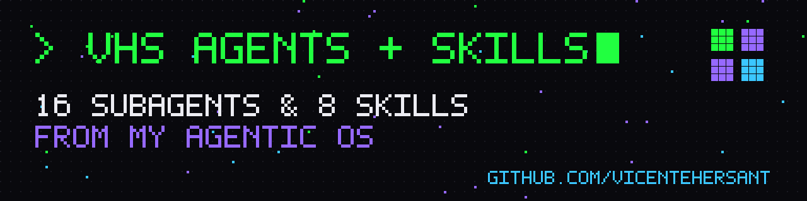
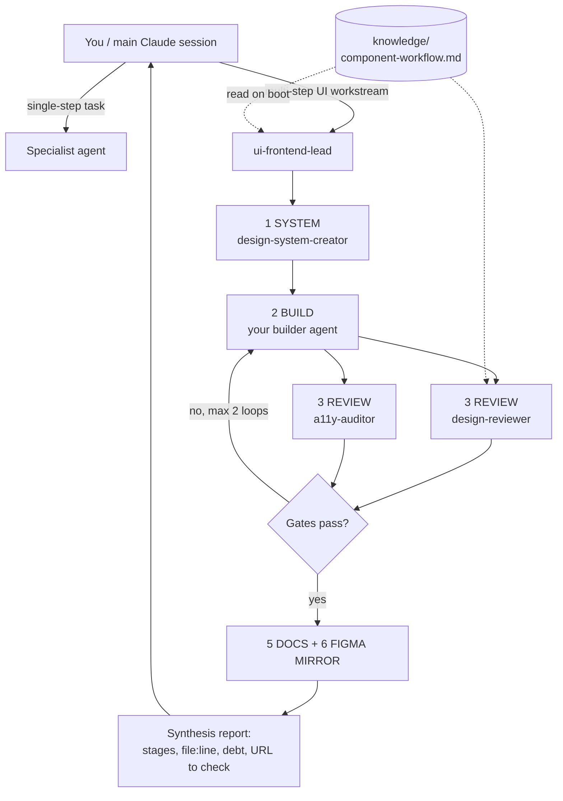

# VHS Agents & Skills

A curated, open-source collection of **Claude Code subagents and skills** for
product design work — UX, UI and design systems, accessibility, research, SEO/GEO,
CRO, branding, UX writing and QA.

They're extracted from **VHS Agentic OS**, a personal "LLM operating system" built
for day-to-day client work by a UX/UI/Product designer who also ships code. Every
piece here has been used on real projects, then made generic for public use.

## What's inside

### Agents (`agents/<cluster>/<name>.md`)

| Cluster | Agent | What it does |
|---|---|---|
| ui-frontend | [`ui-frontend-lead`](agents/ui-frontend/ui-frontend-lead.md) | Cluster lead: runs system → build → review + a11y → docs → Figma mirror end to end, delegating to specialists |
| ui-frontend | [`design-system-creator`](agents/ui-frontend/design-system-creator.md) | Authors `design.md` and governs the token → primitive → component → section library |
| ui-frontend | [`design-reviewer`](agents/ui-frontend/design-reviewer.md) | Senior design critique: hierarchy, spacing rhythm, type, states, consistency gates |
| ui-frontend | [`a11y-auditor`](agents/ui-frontend/a11y-auditor.md) | WCAG 2.2 AA auditor and fixer for shipped code, with computed contrast ratios |
| ui-frontend | [`a11y-designer`](agents/ui-frontend/a11y-designer.md) | Accessibility at the design stage: contrast matrices, focus tokens, motion policy, Figma annotations |
| ui-frontend | [`web-inspector`](agents/ui-frontend/web-inspector.md) | Reverse-engineers a site: extracts its design system, recreates elements, explains effects |
| ui-frontend | [`style-curator`](agents/ui-frontend/style-curator.md) | Recommends visual style and grid/layout system from a curated taxonomy; runs trend scans |
| ux | [`ux-heuristics-expert`](agents/ux/ux-heuristics-expert.md) | Evaluates flows against UX laws (Hick, Fitts, Jakob, peak-end…) and settles design debates |
| research | [`deep-researcher`](agents/research/deep-researcher.md) | Sourced, numbered, decision-ready research reports |
| research | [`research-users`](agents/research/research-users.md) | Interview/usability study design, scripts, synthesis, evidence-based archetypes |
| seo | [`seo-geo-strategist`](agents/seo/seo-geo-strategist.md) | Technical SEO + GEO (AI search): audits, topic clusters, schema, AI-citability |
| cro-analytics | [`cro-auditor`](agents/cro-analytics/cro-auditor.md) | Conversion audits with scored framework and hypothesis tables; ships quick wins |
| cro-analytics | [`funnel-analyst`](agents/cro-analytics/funnel-analyst.md) | Maps and quantifies the real funnel, diagnoses drop-off, designs the target funnel |
| branding | [`brand-strategist`](agents/branding/brand-strategist.md) | Positioning, territory, value pyramid, audiences, price-tier verdict, brand metrics |
| content | [`ux-writer`](agents/content/ux-writer.md) | Interface microcopy and glossary ownership (buttons, errors, empty states, forms) |
| qa | [`qa-engineer`](agents/qa/qa-engineer.md) | Pragmatic test plans and tests, plus an evaluation rubric for AI/RAG output |

### Skills (`skills/<name>/SKILL.md`)

| Skill | What it does |
|---|---|
| [`design-system-guardian`](skills/design-system-guardian/SKILL.md) | Enforces tokens, reuse, contrast and consistency before/after any visual change |
| [`site-sweep`](skills/site-sweep/SKILL.md) | Protocol for "change it everywhere" requests: enumerate → apply → grep-verify → report |
| [`a11y-wcag`](skills/a11y-wcag/SKILL.md) | WCAG 2.2 AA checklist ordered by real-world failure frequency |
| [`cro-audit`](skills/cro-audit/SKILL.md) | Clarity → Friction → Motivation → Trust → Attention framework with scored output |
| [`seo-geo-pass`](skills/seo-geo-pass/SKILL.md) | Technical SEO + GEO pass: indexability, schema, cluster strategy, LLM-citable content |
| [`deep-research`](skills/deep-research/SKILL.md) | Folder convention and report structure for persistent research |
| [`brand-book`](skills/brand-book/SKILL.md) | Brand book TOC, format decision, brand-pack folder and delivery quality gates |
| [`user-testing-synthesis`](skills/user-testing-synthesis/SKILL.md) | Recordings + transcripts → color-coded, evidence-linked usability report |

### Knowledge (`knowledge/`)

Shared reference files some agents read on start ("thin agents, fat knowledge"):

| File | Used by |
|---|---|
| [`component-workflow.md`](knowledge/component-workflow.md) | ui-frontend-lead, design-system-creator, design-reviewer |
| [`list-table-ui.md`](knowledge/list-table-ui.md) | ui-frontend-lead, design-system-creator, design-reviewer |
| [`styles-taxonomy.md`](knowledge/styles-taxonomy.md) | style-curator |
| [`layouts-grids.md`](knowledge/layouts-grids.md) | style-curator |
| [`ux-laws.md`](knowledge/ux-laws.md) | ux-heuristics-expert |

## Install

Claude Code loads subagents from `~/.claude/agents/` (global) or `.claude/agents/`
(per project), and skills from `~/.claude/skills/` or `.claude/skills/`.

```bash
git clone https://github.com/Vicentehersant/vhs-agents-and-skills.git
cd vhs-agents-and-skills

# One agent, globally
mkdir -p ~/.claude/agents
cp agents/ui-frontend/design-reviewer.md ~/.claude/agents/

# One skill, in a single project
mkdir -p /path/to/project/.claude/skills
cp -R skills/a11y-wcag /path/to/project/.claude/skills/

# Everything, globally (agents are flattened; names are unique)
mkdir -p ~/.claude/agents ~/.claude/skills
cp agents/*/*.md ~/.claude/agents/
cp -R skills/* ~/.claude/skills/
```

**Knowledge files.** Agents reference `knowledge/<file>.md`. Copy the folder into
your project root (`cp -R knowledge /path/to/project/`), or into `~/.claude/knowledge/`
and edit the paths in the agents you use. Agents without a knowledge dependency
work on their own.

**Tools.** Agents that omit the `tools:` field inherit every tool in your session,
including MCP servers such as Figma or Chrome DevTools if you have them connected.
Others declare a minimal tool list — edit it to taste.

Then just ask: *"Use the design-reviewer agent on the pricing section"*, or let
Claude pick the agent from its description.

## How the cluster / lead pattern works

Agents are grouped into **clusters** by domain. Most tasks go straight to one
specialist. Multi-step workstreams go to a **cluster lead**, which owns the loop,
delegates each stage to a specialist with exact file ownership, and acts as the
quality gate between stages — so the main session never has to micro-manage.



Design principles behind it:

- **Context is RAM.** Agents load only the knowledge they need, when they need it.
- **Thin agents, fat knowledge.** Judgment lives in the agent; facts and playbooks
  live in `knowledge/`, editable without touching agents.
- **Verification-first.** Every agent ends with checkable output (tables,
  file:line, computed numbers), never "looks good".
- **Ask-first.** On material ambiguity, agents stop and ask (or return the
  question to their caller) instead of guessing.

## Contributing

See [CONTRIBUTING.md](CONTRIBUTING.md).

## License

[MIT](LICENSE)

## Credits

Built by **Vicente Hernaiz** · [vicentehernaiz.tech](https://vicentehernaiz.tech)
